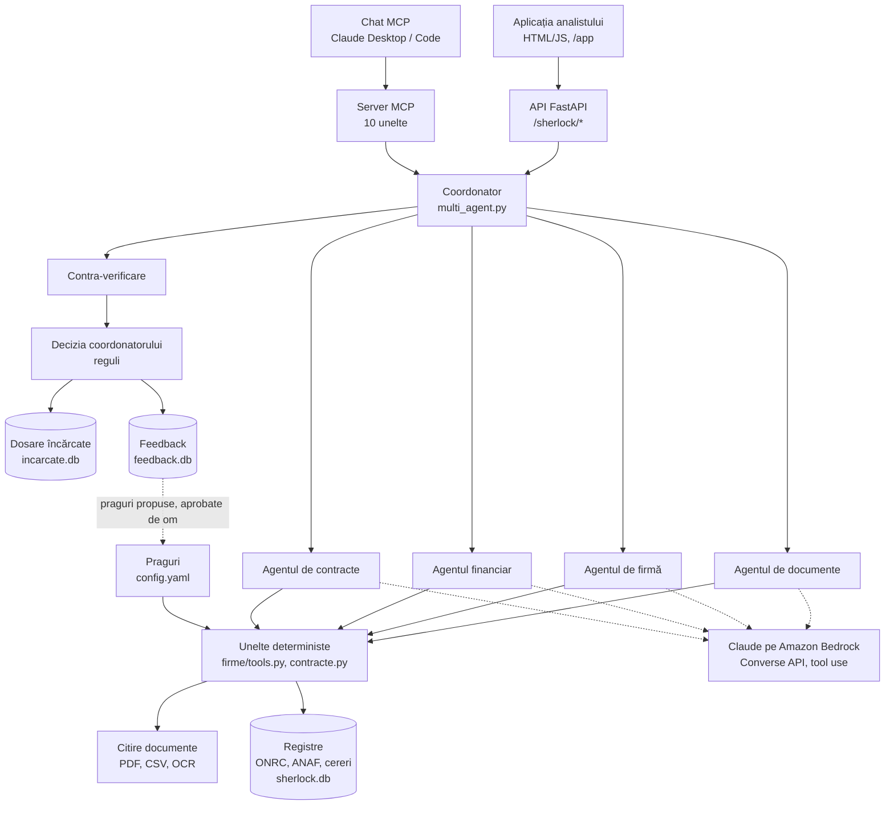

# Sherlock: arhitectura soluției

**NEXXT AI Summit 2026 · Raiffeisen „AI for Operational Efficiency” · 29.10.2026**

Agentul antifraudă pentru creditele firmelor și PFA: arhitectura, fluxul de date și logica agenților, cum acoperă
fiecare criteriu al juriului, scenariul de demo și testele.

**Cuprins:** [Rezumat](#rezumat) · [Criteriile juriului](#criteriile-juriului-ce-avem-și-cum-dovedim) ·
[Arhitectura](#arhitectura) · [Fluxul unui dosar](#fluxul-unui-dosar) · [Agenții și uneltele](#agenții-și-uneltele) ·
[Situații neprevăzute](#situații-neprevăzute) · [Reguli și praguri](#reguli-și-praguri-configyaml) ·
[Scenariul de demo](#scenariul-de-demo) · [Teste](#teste) · [Instalare](#instalare) ·
[Valoare și adopție](#valoare-și-adopție) · [Pași următori](#pași-următori)

## Rezumat

**Problema.** Băncile verifică firmele la ANAF, dar ANAF arată ce s-a declarat, nu dacă e adevărat. În cazul din Argeș
(2026), angajați fictivi au fost declarați direct la ANAF, iar băncile au aprobat creditele după verificarea la ANAF.

**Soluția.** Sherlock investighează dosarul de credit cu patru sub-agenți specializați și verifică dacă cifrele se
regăsesc în realitate: banii intră în cont, salariile se plătesc, clientul din contract există și plătește, firma nu
face parte dintr-o rețea.

**Rezultatul pe 253 de dosare de test:** 92% din fraude prinse, față de 23% la verificarea clasică ANAF, cu 0 alarme
false pe 227 de dosare legitime și 22,16 mil. lei credite frauduloase oprite.

## Criteriile juriului: ce avem și cum dovedim

| Pondere | Criteriu | Ce avem | Dovada |
|---|---|---|---|
| 25% | Profunzime, design, orchestrare | coordonator + 4 sub-agenți, fiecare doar cu uneltele lui (tool use nativ în Bedrock); decizii în mai mulți pași: investigație → control automat → contra-verificare → decizie → cerere de documente → reluare; agent de lizibilitate, izolarea documentelor manipulate, rezervă când Claude nu răspunde | jurnalul de audit al fiecărui dosar |
| 20% | Prototip funcțional | rulează live: încărcarea în fața juriului a două dosare noi, în alt format; baza dosarelor încărcate, reîncărcarea documentelor, decizia analistului | 37 de teste automate, 22 de teste manuale, `run_eval.py` |
| 15–20% | Concept, originalitate | confruntă declarațiile cu banii reali (încasări, salarii, plățile din contracte); rețele de firme pe tot portofoliul, fără fereastră de timp; reguli bancare reale: CUI, ANAF, registrul comerțului, AI Act | tiparele de fraudă și comparația cu verificarea clasică |
| 15% | Arhitectură, reproductibilitate | unelte deterministe separate, praguri în `config.yaml`, furnizor LLM schimbabil; API REST documentat (`/docs`), server MCP, SQLite înlocuibil cu registrele reale; instalare în 6 comenzi, date sintetice regenerabile | README și [instalarea](#instalare) |
| 10% | Business | mai puțină muncă pentru analist: doar 4% din dosarele legitime ajung la el; credite frauduloase oprite; scanarea portofoliului existent (Garanti BBVA); adopție: pilot în umbră, apoi integrare prin API | pagina Rezultate și scanarea portofoliului |

## Arhitectura

**Principiul: LLM-ul orchestrează, codul decide.** Claude alege verificările, citește documentele fără format fix și
explică; uneltele deterministe calculează; verdictul vine din reguli, cu dovezi.



| Componentă | Fișier | Rol |
|---|---|---|
| Coordonator | `sherlock/multi_agent.py` | sub-agenți, control automat, contra-verificare, decizie, cereri de documente, lizibilitate |
| Bucla agentului | `sherlock/agent.py` | tool use, controlul automat, scorul de risc, verdictul |
| Unelte | `sherlock/firme/tools.py`, `contracte.py` | verificările, fiecare cu dovezi |
| Citire | `sherlock/firme/citire.py` | etichete alternative, diacritice, tabele, extrase de la orice bancă, OCR |
| LLM | `sherlock/llm.py` | Claude pe Bedrock (sau Featherless), aceeași interfață |
| Dosare încărcate | `sherlock/incarcate.py` | bază pornită goală, documente, rezultate, documente înlocuite |
| Feedback, portofoliu | `sherlock/feedback.py`, `portofoliu.py` | precizia verificărilor, praguri propuse, rețele pe tot portofoliul |
| Interfețe | `sherlock_api.py`, `mcp_server.py`, `app/index.html` | API REST, chat MCP, aplicația analistului |

## Fluxul unui dosar

1. **Încărcare.** Analistul încarcă PDF-urile și extrasul CSV. Dosarul primește un număr (N001…), documentele se
   salvează în baza dosarelor încărcate.
2. **Citire.** Fiecare document e clasificat după conținut și nume. Câmpurile se extrag cu reguli; ce lipsește
   completează Claude, iar o valoare e acceptată doar dacă apare literal în document. Documentele scanate trec prin
   OCR sau Claude (imagine).
3. **Agentul de documente, primul.** Verifică dosarul complet și caută text ascuns. Un document manipulat e izolat:
   textul lui nu mai ajunge la LLM.
4. **Ceilalți trei sub-agenți.** Fiecare rulează cu Claude, cu doar uneltele zonei lui, și scrie un raport cu cifrele
   din rezultate.
5. **Controlul automat.** Rulează orice verificare obligatorie pe care un sub-agent a omis-o.
6. **Contra-verificarea.** Pentru fiecare alarmă, Claude formulează cea mai bună explicație legitimă. Coordonatorul o
   acceptă doar dacă e confirmată de verificări independente. O alarmă critică nu se anulează fără documente noi.
7. **Decizia.** Codul calculează statusul și scorul de risc. Claude redactează concluzia, fără să poată schimba verdictul.
8. **Cereri.** Coordonatorul cere clientului documentele care lămuresc o îndoială. Agentul de lizibilitate cere copii
   lizibile. Fiecare document nou reia investigația.
9. **Decizia analistului.** Se salvează în jurnalul de audit, cu override. Feedback-ul pe alarme duce la praguri
   propuse, validate pe dosare nevăzute și aprobate de un om.

## Agenții și uneltele

| Agent | Unelte | Ce decide |
|---|---|---|
| Agentul de documente | `lista_documente`, `verifica_documente_obligatorii`, `scaneaza_instructiuni_ascunse` | dosar complet; text ascuns → critic, document izolat; scanări necitite |
| Agentul de firmă | `verifica_identitate_firma`, `verifica_statut_fiscal`, `verifica_istoric_firma`, `verifica_retea` | CUI valid, firmă activă, datorii; firmă preluată (administrator nou + creștere bruscă); rețea de solicitanți |
| Agentul financiar | `extrage_campuri`, `verifica_bilant_vs_anaf`, `verifica_flux_cont`, `verifica_salarii`, `verifica_capacitate_plata` | bilanț față de ANAF; încasări reale față de cifra declarată; salarii plătite față de angajații de la ANAF |
| Agentul de contracte | `extrage_campuri`, `verifica_contracte` | beneficiarul există, are cifră de afaceri, nu e nou sau legat de solicitant, plătește efectiv |
| Contra-verificare | LLM pentru argumente, reguli pentru decizie | ce alarme primesc o explicație legitimă confirmată |
| Agentul de lizibilitate | OCR, Claude (imagine) | ce document trebuie reîncărcat și de ce |

**Statusul dosarului:** *Dosar eligibil* – nicio problemă · *De verificat* – avertizare sau document lipsă ·
*Dosar neeligibil* – cel puțin o problemă critică.

**Scorul de risc:** critică = 35 de puncte, document lipsă = 15, avertizare = 12, plafon 100, calculat după
contra-verificare.

## Situații neprevăzute

| Situație | Ce face Sherlock |
|---|---|
| Claude nu răspunde (token expirat, rețea) | verdictul rămâne al regulilor; concluzia se scrie automat; interfața arată „Claude indisponibil” |
| Un sub-agent sare o verificare | controlul automat o rulează și o atribuie sub-agentului responsabil |
| Document cu instrucțiuni ascunse pentru AI | alarmă critică, documentul e izolat de LLM, verificările deterministe continuă |
| LLM-ul inventează o valoare | respinsă: orice valoare extrasă de LLM trebuie să apară literal în document |
| Document scanat ilizibil | Claude răspunde „ILIZIBIL”, nu ghicește; se cere reîncărcarea; cererea se repetă până la o copie bună |
| Format necunoscut (altă bancă, alte etichete) | etichete alternative din config, coloane debit/credit, formate de sumă și dată, clasificare după conținut |
| Document obligatoriu lipsă | status „de verificat”, mesaj pentru client |
| Îndoială care se poate lămuri (cash, salarii din alt cont) | cerere de documente către client; răspunsul reia investigația |
| Fișier nepermis sau cale manipulată | refuzat înainte să se creeze dosarul |
| Analistul nu e de acord | decizia lui primează, marcată override în jurnal |

## Reguli și praguri (`config.yaml`)

| Verificare | Avertizare | Critic |
|---|---|---|
| Bilanț față de ANAF (diferență) | > 8% | > 25% |
| Banii din cont (încasări / cifra declarată) | < 75% | < 50% |
| Salarii (plăți / minim așteptat, de la 3 angajați) | < 60% | < 30% |
| Istoric: administrator schimbat în ultimele 6 luni | singur | + creștere ×4 sau credit mare |
| Rețea (în 180 de zile) | 1 firmă legată | ≥ 2 firme legate |
| Contract: valoare anuală / cifra beneficiarului | > 50% | > 100% |
| Contract: plăți primite / așteptate | < 50% | < 10% |
| Statut fiscal: datorii ANAF | > 50.000 lei | firmă inactivă |

Pragurile s-au ales pe setul de calibrare și se măsoară pe setul de test. Se schimbă doar prin aprobare umană, cu jurnal.

## Scenariul de demo

Demo-ul se face pe două dosare noi, pe care Sherlock nu le-a analizat înainte, în alt format decât dosarele de
pregătire: tabele cu diacritice, alte etichete, alte nume de fișiere, extras de la altă bancă. Fișierele:
[`demo_dosare/test_nou/`](../demo_dosare/test_nou).

| Dosar | Ce vede juriul | Rezultat |
|---|---|---|
| A · ARCADIA CATERING EVENIMENTE SRL, credit 280.000 lei | administrator schimbat acum 4 luni → avertizare la Agentul de firmă; contra-verificarea o lămurește (cifre stabile, ×1,1; banii din cont confirmă) | Dosar eligibil, risc 0 |
| B · NORDIC STEEL MONTAJ SRL, credit 900.000 lei | bilanțul e identic cu ANAF, deci verificarea clasică ar aproba. Sherlock găsește: text ascuns în contract (documentul e izolat); 22 de angajați la ANAF, salarii pentru 3; 42% din bani în cont; beneficiarul contractului de 1,8 mil. lei e înființat cu o lună înainte, are același telefon și nu are cifră de afaceri | Dosar neeligibil, risc 100 · 3 sub-agenți fără OK |

| Pas | Durată | Ce arătăm |
|---|---|---|
| Problema | 30 s | ANAF arată ce s-a declarat; cazul Argeș |
| Dosarul A | 60 s | încărcare live; card verde. Detalii → Contra-verificare: alarma a fost lămurită, nu ignorată |
| Dosarul B | 90 s | încărcare live; card roșu, „Nu au dat OK” pentru 3 sub-agenți. Detalii pe Agentul financiar (angajații fictivi, ca în Argeș), pe Agentul de contracte (firma-paravan) și pe Agentul de documente (textul ascuns, izolat) |
| De ce e roșu | 30 s | Detalii pe dosar: scorul calculat de cod, contra-verificarea, concluzia scrisă de Claude |
| Documentul ilizibil | 40 s | `3_document_ilizibil`: cererea de reîncărcare, apoi verde |
| Portofoliu și cifre | 40 s | grupurile de firme legate; Rezultate: 92% față de 23% |
| Decizia analistului | 20 s | salvată, apare în Feedback |

## Teste

- **37 de teste automate:** `cd backend && python -m pytest -q tests`. Includ dosarele demo, dosarele noi, baza
  dosarelor încărcate, reîncărcarea și fișierele nepermise.
- **Evaluare:** `python run_eval.py --comparatie` reproduce tabelul de rezultate pe 253 de dosare.
- **22 de teste manuale** pentru ziua demo-ului, în [`docs/QA_MANUAL.md`](QA_MANUAL.md): conexiunea cu Claude, baza
  goală, cele 5 dosare, butoanele Detalii, reîncărcarea, lista și filtrul, decizia și override-ul, portofoliul, Claude
  indisponibil, fișier nepermis, afișarea pe telefon.
- **Test cap-coadă în browser** (Playwright): încărcarea prin interfață, statusurile, butoanele Detalii, reîncărcarea,
  decizia, afișarea pe telefon.

| Configurație (253 de dosare de test) | Fraude prinse | Precizie | Alarme false | Legitime la analist | Credite oprite |
|---|---|---|---|---|---|
| Verificare clasică ANAF | 23% | 100% | 0 | – | 1,55 mil. lei |
| Agent simplu | 92% | 75% | 8 | 25% | 22,16 mil. lei |
| Multi-agent | 92% | 75% | 8 | 9% | 22,16 mil. lei |
| **Sherlock complet** | **92%** | **100%** | **0** | **4%** | **22,16 mil. lei** |

## Instalare

```powershell
git clone https://github.com/andremm-svg/Challenge_NextAISummit.git
cd Challenge_NextAISummit/backend
python -m venv .venv
.\.venv\Scripts\Activate.ps1
pip install -r requirements.txt
copy .env.example .env      # LLM_PROVIDER=bedrock, BEDROCK_MODEL_ID, AWS_REGION, AWS_BEARER_TOKEN_BEDROCK
python -m uvicorn main:app --reload
```

Aplicația: `http://127.0.0.1:8000/app/` · API: `/docs` · chat MCP: `.mcp.json` din rădăcina repo-ului. Datele
sintetice se regenerează cu `python tools_dev/generate_firme.py`.

## Valoare și adopție

- **Utilizatorul:** analistul de credit și echipa antifraudă. Vede în câteva secunde ce sub-agent nu a dat OK și de ce,
  cu dovezile.
- **Valoarea:** fraude prinse pe care verificarea la ANAF nu le vede; mai puține dosare legitime trimise la analist
  (4%); scanarea portofoliului existent, inclusiv cel preluat de la Garanti BBVA.
- **Context:** creditele corporate Raiffeisen au crescut cu 17%, la 29 mld. lei; creditele neperformante ale
  microîntreprinderilor depășesc 7%.
- **Adopție:** pilot în umbră, pe dosare reale, în paralel cu analiștii; apoi integrare prin API în fluxul de
  creditare; extrasele direct de la bănci (Open Banking); registrele reale (ONRC, ANAF) în locul bazei sintetice.
- **Conformitate:** decizia e umană, jurnal de audit, praguri aprobate de om, model rulat în infrastructura băncii
  (AI Act, GDPR).

## Pași următori

În ordinea impactului pe punctaj:

1. **Repetiția demo-ului pe dosarele noi (20%):** testele manuale din `docs/QA_MANUAL.md`, apoi filmarea de rezervă.
2. **Chat-ul MCP pe dosarele încărcate (25%):** uneltele MCP văd azi doar dosarele de test; adăugarea dosarelor
   încărcate permite întrebări în chat despre dosarele din demo.
3. **Explicații de business în concluzie (10%):** suma care ar fi fost pierdută și ce ar fi aprobat verificarea clasică.
4. **Diagrama și acest document în materialele trimise (15%),** cu link la repo și la instrucțiunile de instalare.
